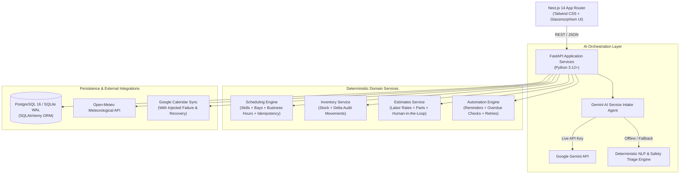

# PitStop AI — Autonomous Workshop Operations Platform 🏎️⚡

[](https://fastapi.tiangolo.com)
[](https://nextjs.org)
[](https://www.python.org)
[](https://www.postgresql.org)
[](https://ai.google.dev)
[](file:///./backend/tests)

**PitStop AI** is an AI-powered operations platform designed for independent automotive workshops. It coordinates unstructured customer requests, work orders, mechanic skill capacity, parts availability, estimates, calendar appointments, and proactive automation through deterministic business rules and an AI orchestration layer.

> Grounded in the **Approved Software Requirements Specification (SRS) v2.0** ([`docs/PitStop_AI_SRS.md`](file:///./docs/PitStop_AI_SRS.md)).

---

## 🏛️ Architecture Overview



---

## 🚀 Key Features & SRS Alignment

1. **AI-Assisted Service Intake & Safety Guardrails (FR-01 to FR-04)**
   - Translates unstructured customer complaints into validated vehicle, symptom, urgency, and duration parameters.
   - **Safety Escalation**: Configured indicators (e.g. spongy brakes, fluid leaks, burning smells) trigger caution advisories and immediate human review without claiming autonomous mechanical diagnosis.
   - Identifies missing fields and asks conversational follow-up questions.

2. **Deterministic Scheduling & Idempotency (FR-06 to FR-08)**
   - Computes conflict-free appointment slots strictly matching technician skills (e.g. brakes certification), bay hydraulic lift capability, and business operating hours.
   - Enforces unique `idempotency_key` headers to prevent accidental double-bookings on client retries.

3. **Inventory & Human-in-the-Loop Estimates (FR-09, FR-10)**
   - Computes parts costs and configured labor rates ($95.00/hr) into draft estimates.
   - Consequential action control: Estimates remain strictly in `draft` status until explicitly authorized by a certified service advisor.

4. **Live Weather Context (FR-11)**
   - Connects to Open-Meteo API for real-time weather data.
   - Provides operational advisories for weather-sensitive jobs (e.g., paint curing, ceramic coating, post-repair brake road testing).

5. **Proactive Automation & Resilience (FR-12, FR-15)**
   - Background worker processes appointment reminders, flags overdue jobs, and alerts on low-stock items.
   - External calendar sync includes bounded retries and an interactive **Failure & Recovery demonstration path**.

6. **Immutable Audit Trail (FR-14)**
   - Logs every mutation, AI extraction outcome, actor identity, and correlation ID in the database.

7. **Vehicle Owner Portal ("My PitStop Garage")**
   - Passwordless email OTP verification with secure single-use codes (15-minute expiration).
   - Real-time registered vehicle cards with mileage counters and recommended maintenance schedules.
   - **5-Stage Live Repair Tracker**: Intake Logged → Bay Inspection → Estimate Ready → In Repair → Ready for Pickup.
   - **Digital Quote Authorization**: Vehicle owners can inspect parts breakdown and authorize work with a single click from their smartphone or desktop.

8. **Event-Driven Email Notification Engine & In-App Outbox**
   - Dispatches branded, responsive HTML transactional emails for OTP access, appointment confirmations (with bay & calendar sync status), estimate authorization requests, and vehicle ready pickup notices.
   - Interactive floating **Email Outbox** drawer in the UI with unread counters and full HTML preview rendering for evaluators.

---

## 🛠️ Tech Stack & Directory Structure

```text
PitStop/
├── frontend/               # Next.js 14 App Router, TypeScript, Tailwind CSS, Lucide
│   ├── src/app/            # App layout, global styles, and reactive dashboard
│   ├── src/lib/api.ts      # Typed backend API client
│   └── Dockerfile          # Multi-stage production container
├── backend/                # FastAPI, Pydantic v2, SQLAlchemy 2.0
│   ├── app/
│   │   ├── models/         # Relational entities (Workshop, WorkOrder, Parts, etc.)
│   │   ├── schemas/        # Pydantic request and response models
│   │   ├── services/       # AI intake, scheduling, inventory, calendar, weather
│   │   ├── routers/        # Clean modular REST endpoints
│   │   ├── config.py       # Environment settings
│   │   ├── database.py     # Database session engine (PostgreSQL & SQLite WAL)
│   │   └── main.py         # App bootstrap with CORS and auto-seeding
│   ├── tests/              # Pytest automated test suite
│   ├── requirements.txt    # Python dependencies
│   └── Dockerfile          # Backend container specification
├── docs/                   # Approved SRS proposal documentation
│   └── PitStop_AI_SRS.md   # Markdown edition of approved SRS v2.0
├── docker-compose.yml      # Orchestration for PostgreSQL, Backend, and Frontend
├── .env.example            # Environment variables template
└── README.md               # Product documentation
```

---

## 🏃 Getting Started (Local Quickstart)

### Prerequisites
- Node.js 18+ (tested on Node v24)
- Python 3.10+ (tested on Python 3.14)

### 1. Environment Configuration
Copy the template environment file:
```bash
cp .env.example .env
```
*(Optional)* Add your `GEMINI_API_KEY` in `.env` if you wish to use live Google Gemini LLM calls. If left empty, PitStop AI seamlessly runs its deterministic NLP engine.

### 2. Backend Setup
```bash
# In repository root
.\backend\venv\Scripts\python -m pip install -r backend/requirements.txt

# Run backend development server
$env:PYTHONPATH="backend"
.\backend\venv\Scripts\python -m uvicorn app.main:app --host 0.0.0.0 --port 8000 --reload
```
The FastAPI backend auto-initializes database tables and seeds demo workshop data on first startup.
- Interactive Swagger API Docs: [http://localhost:8000/docs](http://localhost:8000/docs)
- Health check: [http://localhost:8000/api/health](http://localhost:8000/api/health)

### 3. Frontend Setup
```bash
cd frontend
npm install
npm run dev
```
Open [http://localhost:3000](http://localhost:3000) to access the PitStop AI operations dashboard.

---

## 🐳 Docker Deployment

To spin up the complete containerized stack (PostgreSQL 16 database, FastAPI backend, and Next.js frontend):
```bash
docker compose up --build
```
Access the application at `http://localhost:3000`.

---

## 🧪 Automated Testing

Execute the comprehensive test suite verifying AI intake, deterministic scheduling, idempotency, inventory deduction, and calendar failure recovery:

```bash
$env:PYTHONPATH="backend"
.\backend\venv\Scripts\pytest backend\tests -v
```

All 5 core test cases pass cleanly:
```text
backend/tests/test_pitstop.py::test_ai_intake_safety_guardrail PASSED           [ 20%]
backend/tests/test_pitstop.py::test_deterministic_scheduling_and_idempotency PASSED [ 40%]
backend/tests/test_pitstop.py::test_inventory_deduction_and_insufficient_stock PASSED [ 60%]
backend/tests/test_pitstop.py::test_human_in_the_loop_estimate_approval PASSED [ 80%]
backend/tests/test_pitstop.py::test_calendar_sync_failure_and_recovery PASSED  [100%]
```

---

## 🎬 Live Demonstration Scenario (SRS Section 18)

1. **AI Intake & Triage**:
   - In the **AI Intake & Triage** tab, click **Brake Failure / Spongy** (or type a concern regarding brakes).
   - Click **Run AI Agent Extraction**.
   - Notice the **Safety-Critical Escalation** banner, caution advisory, duration calculation (90 mins), and recommended parts (`Premium Ceramic Brake Pads`, `DOT4 Fluid`).
   - Click **Persist Draft Request** and reply to the clarification prompt.
   - Click **Approve & Convert to Work Order**.

2. **Work Order & Human-in-the-Loop Estimate**:
   - In the **Work Orders & Estimates** tab, select the newly converted work order.
   - Click **Calculate Draft Estimate**. View the calculated labor hours ($95/hr) and line-item parts.
   - Click **Authorize Estimate (Human-in-the-Loop)** to confirm approval.

3. **Deterministic Scheduling & Idempotency**:
   - In the **Bay Scheduling & Calendar** tab, view the certified feasible slots for today.
   - Click **Confirm Slot (Idempotent)** to book the appointment.
   - Notice the appointment is committed and synchronized with Google Calendar.

4. **Integration Failure & Recovery Path**:
   - In the scheduled appointments table, click **Trigger 503 Failure** on an appointment to simulate an external timeout.
   - Observe the `failed` status and the background retry job queued in the audit log.
   - Click **Sync OK** to demonstrate successful automatic recovery and event sync.

---

## 📄 License
Prepared for Brain3.ai AI SWE Project Design Review & Demonstration.
